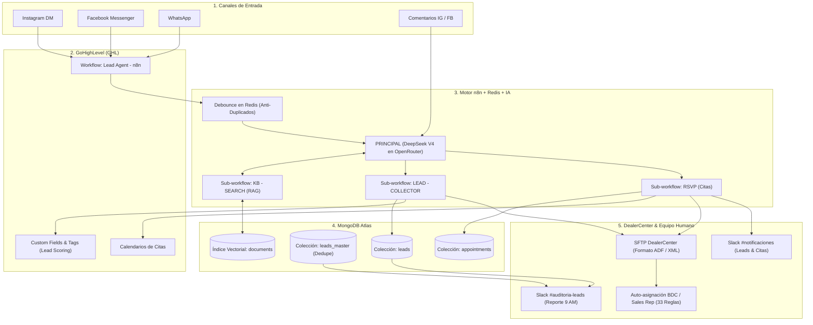

# Ecosistema Tecnológico Completo — Carwarriors LLC & Rances Car

> [!abstract] Resumen Ejecutivo
> Este documento detalla la totalidad de la infraestructura, sistemas de automatización, agentes de Inteligencia Artificial y configuraciones comerciales construidas por **FORJADO** para el concesionario automotriz **Carwarriors LLC** y su sede hermana **Rances Car** en Miami, Florida.
> 
> El ecosistema reemplazó la solución nativa limitada de GoHighLevel (*Conversation AI*) por una arquitectura propia basada en **n8n self-hosted**, **MongoDB Atlas**, **OpenRouter (DeepSeek V4)**, **DealerCenter (DMS)** y **Slack**, logrando control total sobre las respuestas, persistencia de datos y sincronización de leads sin costos desproporcionados de plataforma.

---

## 1. Stack Tecnológico de Infraestructura

| Capa / Módulo | Tecnología / Proveedor | Función Principal y Especificaciones |
| :--- | :--- | :--- |
| **Servidor / Hosting** | **Hostinger KVM 1 VPS** | Servidor dedicado Linux Ubuntu (IP `2.24.106.87`), hosting de bajo costo (~$8/mes) para la suite completa. |
| **Orquestación PaaS** | **Coolify v4.1.2 + Docker** | Gestión de contenedores en producción, despliegues sin caída y aislamiento de redes internas. |
| **Motor de Automatización** | **n8n Self-Hosted (Queue Mode)** | Orquestador de toda la lógica de negocio y agentes IA. Configurado con Worker separado y base interna **PostgreSQL 16**. |
| **Caché y Colas** | **Redis 6 Alpine** | Manejo de colas y **debounce anti-duplicados** (agrupa mensajes seguidos de un mismo lead en una sola llamada a la IA). |
| **Base de Datos & Vectores** | **MongoDB Atlas M0 (Cloud)** | Persistencia de `leads`, `leads_master` (dedupe multi-dealer), `appointments`, `dealercenter_customers`, `agent_errors` y RAG vectorial (`documents`). |
| **Inferencia de IA (LLMs)** | **OpenRouter (DeepSeek V4 Flash)** | Modelos cognitivos pay-per-use de alta velocidad, configurados con salida JSON estricta (`responseFormat: json_object`). |
| **CRM Comercial** | **GoHighLevel (GHL)** | Gestión de contactos y omnicanalidad (Instagram, Facebook Messenger, WhatsApp, SMS) vía **Private Integration Tokens (PIT)**. |
| **DMS Automotriz** | **DealerCenter** | Sistema de inventario y CRM del concesionario. Integrado vía **SFTP (ADF/XML)**, reenvío de correo y reportes programados. |
| **Alertas & Equipo** | **Slack API (Bot FORJADO)** | Notificaciones operativas a vendedores en `#notificaciones` y reportes de auditoría en `#auditoria-leads`. |
| **Redes Sociales** | **ManyChat + Meta Graph API** | Captación de nuevos seguidores en Instagram y procesamiento de comentarios con IA. |

---

## 2. Todo lo Realizado en DealerCenter (DMS & CRM)

> [!info] Rol de DealerCenter
> DealerCenter es la fuente de verdad del inventario de vehículos, el control de ventas físicas en lote y la asignación de prospectos a los agentes comerciales (BDC y Sales Reps).

### A. Configuración de 33 Reglas de Custom Lead Assignment
Se configuró y auditó la matriz completa de auto-asignación por fuente para garantizar que ningún lead quede huérfano:
- **Regla 33 (`META CW`):** Asignada directamente a **Jean Cue** como BDC Rep para prospección prioritaria de campañas de Meta.
- **Reglas 16, 17 y 18 (`Capital One` Auto Navigator y Shopper):** Asignadas a **Dayron Barrizonte**, configurando a **Nacira Estefan** como respaldo automático si Dayron está fuera de turno.
- **Reglas 7 a 15 (9 reglas de `CarGurus`):** Configuradas para asignar a **Carlos Martínez** (`Carlos4125`) directo en **Sales Rep**, retirando a Scarleth y Samuel de BDC Rep para que los leads de CarGurus entren directo al vendedor de piso.
- **Regla 32 (`OfferUp`):** Asignada a **Carlos Martínez**.
- **Reglas de Trade-In y Rances:** Enrutamiento específico para `CW TRADE IN` (**Nallely de León**) y Referidos Rances Car (**Scarleth Rubi**).

### B. Resolución de Ticket de Soporte Técnico Oficial (`#TICKET-20586098`)
- **Problema:** Un bug nativo del motor de DealerCenter provocaba que leads sin BDC Rep se desviaran indebidamente hacia Alejandra Roa.
- **Resolución:** Se gestionó y verificó con el soporte de DealerCenter la resolución del caso. Se auditó en vivo la grilla de clientes confirmando que los prospectos respetan la asignación a piso sin desviaciones.

### C. Integración SFTP + ADF/XML de Leads en Tiempo Real
- Workflow `Subir a DealerCenter` en n8n:
  - Transforma leads captados por WhatsApp o redes sociales al estándar automotriz **ADF/XML**.
  - Sube los prospectos de forma segura al servidor SFTP de DealerCenter.
  - Consulta previa a MongoDB para **deduplicar** y no saturar el DMS con contactos repetidos.
  - Normalización de fuentes de entrada (`META CW`, `TESLA CW`, `TRADE IN RANCES`, `CW TRADE IN`).

### D. Scheduled Reports (Reportes Nativos Programados)
- **Reporte `FORJADO Lead Sync` (Report ID: `1878845`):** Creado y enriquecido con campos clave (`BDC Rep`, `Follow Up Date`, `Created By`, `Last Activity Create Date`). Se envía diario por correo a n8n para sincronización inversa hacia Mongo y GHL.
- **Reporte `Sold Vehicles`:** Configurado con filtro `Sale Type = Retail` para exportación periódica por email, parseado automáticamente en n8n para el reporte mensual de ventas por marca/modelo en Slack.

### E. Auditoría Diaria de Leads Incompletos (SOP de Bianca Cangialosi)
- Workflow activo a las **09:00 AM hora Miami** en n8n:
  - Audita la base de datos de DealerCenter (`dealercenter_customers`).
  - Detecta leads sin asesor asignado o **sin tarea/cita futura programada**.
  - Alerta directamente en el canal **`#auditoria-leads`** de Slack, haciendo cumplir la política operativa: *"Lead sin task = cliente perdido"*.

### F. Auditoría de 13 Módulos y Catálogo de Automatizaciones
- Análisis completo de los 13 módulos de DealerCenter y exploración de endpoints internos (`CRMCustomReport/GetActivitiesReport`).
- Configuración de buzón de ingesta ADF (`14031841@leadsprod.dealercenter.net`) y lead forwarding (`dc-leads@catalogocarwarriosllc.com`).
- Catálogo documentado de 5 automatizaciones de alto impacto: Alertas F&I de crédito, vehículos sin fotos o precios, control de pagos de floor plan y reasignación de seguimientos.

---

## 3. Todo lo Realizado en GoHighLevel (GHL)

> [!info] Rol de GoHighLevel
> GHL opera como el CRM omnicanal para la atención directa con el comprador (Instagram DM, Facebook Messenger, WhatsApp y SMS).

### A. Desactivación de Conversation AI Nativo
- Se auditaron y apagaron los agentes nativos de GHL que presentaban alucinaciones o respuestas duplicadas (`Asistente Social CarWarriors` y `Asistente Nocturno CarWarriors`).
- Se localizó y apagó de emergencia el agente `Agente Social RancesCar` (que continuaba activo en `auto-pilot` enviando respuestas no deseadas a los leads de Rances Car), centralizando el 100% de las respuestas en n8n.

### B. Construcción de Workflows Nativos de Activación (`Lead Agent - n8n`)
- Construcción y publicación del workflow en la carpeta `Agente AI` en ambas subcuentas:
  - **Carwarriors LLC:** Location ID `DSe5PdPEScZL8cbZTkKI`.
  - **Rances Car:** Location ID `1j1dHo8HEbZdElQUGFoC`.
- **Estructura de Triggers:** Disparadores paralelos `Customer Replied` filtrando por canal (**Instagram DM** y **Facebook Messenger**).
- **Custom Webhook:** Envío de payload JSON limpio hacia los webhooks de n8n conteniendo `contactId`, `contactName`, `message` y `locationId` fijo (blindado contra errores de merge tags de GHL).
- Saneamiento y archivado del workflow antiguo `N8N`.

### C. Mapeo y Normalización de 32 Custom Fields
Estructuración de campos personalizados en GHL consumidos y actualizados por los agentes de IA:
- **Inventario e Interés:** `Interes de Vehiculo`, `Stock Number`, `listing_id`, `listing_code`, `brand`.
- **Cualificación Financiera:** `Metodo de Pago`, `Tiempo estimado de compra`, `Motivo de compra / necesidad principal`.
- **Atribución de Marketing:** `lead_source`, `source_platform`, `Canal Preferido`, `Tipo de Campaña`.
- **Campos de IA:** `Resumen AI` (análisis ejecutivo de la necesidad del cliente para el vendedor), `Lenguaje Preferido`.

### D. Gestión de Calendarios y Sincronización de Citas
- Auditoría de los 5 calendarios de la cuenta (`Showroom — Advisors`, `BDC Callback`, `Maria Eleonor Zurita`, etc.).
- Persistencia de **`ghl_event_id`** en MongoDB Atlas tras la creación de citas por el bot `RSVP`, permitiendo que las acciones automáticas de **reagendamiento** y **cancelación** interactúen nativamente con la API de calendarios de GHL (`/calendars/events/appointments`).

### E. Lead Scoring Dinámico (Etiquetas) & Pipelines
- Evaluación en tiempo real de la intención del prospecto e inyección de tags en GHL: `lead-caliente`, `lead-tibio` o `lead-frio`.
- Enrutamiento con el pipeline principal `CarWarriors – Venta & Financing` (9 etapas: Nuevo Lead, Contactado, Seguimiento, Pre Cita, Agendado Cita, Post Cita, Vendido, Perdido, Lista Negra).
- Rotación y seguridad de Private Integration Tokens (PIT) con 12 scopes autorizados.

---

## 4. Agentes de IA y Sub-Workflows en n8n

> [!tip] Arquitectura Tool-Calling
> Los agentes no responden con texto libre descontrolado. Utilizan un modelo cognitivo que invoca herramientas modulares según la necesidad del prospecto.

### A. Agente Central (`PRINCIPAL` & `PRINCIPAL - Rances Car`)
- **Playbook BDC:** Manejo de urgencia, enfoque en $0 enganche, financiamiento con ITIN/Pasaporte y técnica de cierre *Two-Option Close* (visita presencial o llamada).
- **Calificación en 5 Pasos:** Vehículo de interés &rarr; Ubicación &rarr; Uso &rarr; Método de pago &rarr; Agendamiento.
- **Reconocimiento de Etapas:** Adapta el saludo si es lead `NUEVO`, en `SEGUIMIENTO` (&le;3 días, va directo a la consulta pendiente) o `FRIO` (&gt;3 días).
- **Guardrails Estrictos:** Localización física real en Miami y prohibición total de inventar precios o stock no registrado.
- **Soporte Bilingüe:** Detección automática de idioma (español / inglés).

### B. Herramientas Auxiliares de los Agentes
1. **`LEAD - COLLECTOR`:** Extrae datos estructurados de la conversación y actualiza MongoDB y GHL.
2. **`KB - SEARCH` + `VECTORIZAR - KB` (RAG Vectorial):** Búsqueda semántica en MongoDB Atlas para resolver dudas sobre políticas, garantías, financiamiento y catálogo de autos.
3. **`RSVP` (Carwarriors y Rances Car):** Agendamiento de citas en zona horaria Miami (`America/New_York` con soporte Luxon para DST) y notificación inmediata a asesores.
4. **`SEND - MEDIA`:** Envío automatizado de fotos y fichas de autos a través de GHL.

### C. Cadencia Saliente y Seguimiento Automático 24h
- Workflow `SEGUIMIENTO SALIENTE - Cadencia 24h (CW + Rances Car)` activo cada 15 min:
  - **Intento 1 (1 hora sin respuesta):** Oferta de cita para hoy.
  - **Intento 2 (5 horas sin respuesta):** Enfoque en aprobación $0 Down y cita para mañana.
  - **Intento 3 (20 horas sin respuesta):** Cierre de descarte (*push-away close*) para reactivar interés.

### D. Red de Alertas y Auditoría en Slack
- **`NOTIFICATIONS`:** Envía alertas enriquecidas a `#notificaciones` para nuevos prospectos calificados, citas confirmadas o escalación humana a Nallely de León.
- **`ERROR HANDLER`:** Captura global conectada como `errorWorkflow` que notifica cualquier fallo técnico en cualquier flujo en tiempo real.
- **`SLACK - INBOUND`:** Receptor de menciones y DMs con filtros anti-bucles infinitos.
- **`MONITOR - Gmail Credential Check`:** Verificación semanal automática del estado de las credenciales de correo.

---

## 5. Inventario Completo de Workflows en n8n (19 Flujos)

| # | Nombre del Workflow | ID de n8n | Estado | Función Operativa |
| :-: | :--- | :--- | :-: | :--- |
| **1** | `PRINCIPAL` | `Kif9lWwDHvR7TT39` | `Activo` | Agente IA conversacional de Carwarriors LLC (orquestador, tool calling, calificación). |
| **2** | `PRINCIPAL - Rances Car` | `N68IYzm4Bf6AVTXP` | `Activo` | Agente IA de Rances Car (paridad 1:1 con CW, webhook y subcuenta propia). |
| **3** | `LEAD - COLLECTOR` | `4r00JFnCyoUpZgXU` | `Activo` | Extracción con LLM de vehículo, enganche, timing de compra y sync a GHL/Mongo. |
| **4** | `RSVP` | `2trw9S1LM8ttZlFb` | `Activo` | Agente de citas de Carwarriors (visita al lote/llamada), persistencia y Slack. |
| **5** | `RSVP - Rances Car` | `lFiO37FkvMmGUsdi` | `Activo` | Agente de citas de Rances Car adaptado a los calendarios de sus asesores. |
| **6** | `KB - SEARCH` | `oB2bc9YTIpXqt5zH` | `Activo` | Búsqueda semántica en base vectorial MongoDB Atlas para responder dudas. |
| **7** | `VECTORIZAR - KB` | `47Lbdo6oI4fUYEzN` | `Activo` | Ingesta, chunking y generación de embeddings para actualizar la KB de autos. |
| **8** | `SEND - MEDIA` | `Gq8DaJm0kr7L4DSu` | `Activo` | Tool para despacho de fotos de autos y fichas técnicas por mensajería GHL. |
| **9** | `Subir a DealerCenter` | `ZxcF7cmf3V8FZabx` | `Activo` | Generación de XML ADF de leads y subida automática por SFTP a DealerCenter. |
| **10** | `DealerCenter -> Mongo -> GHL (Lead Sync)` | `EIF9ufLxqoFWZtQ0` | `Activo` | Ingesta diaria del reporte de DealerCenter para sincronizar estados en Mongo/GHL. |
| **11** | `DealerCenter -> Slack (Reporte Diario Leads)` | `jc317DtnKMYEscC5` | `Activo` | Cron 09:00 AM que audita leads sin vendedor o sin tarea agendada (`#auditoria-leads`). |
| **12** | `DealerCenter -> Slack (Ventas Retail)` | `31dHApU2tl76cG4B` | `Activo` | Reporte mensual que consolida las ventas retail por marca/modelo a Slack. |
| **13** | `SEGUIMIENTO SALIENTE - Cadencia 24h` | `Fh4fB5Cgk1hchvxe` | `Activo` | Cron cada 15 min con secuencia de 3 intentos (1h, 5h, 20h) para leads sin respuesta. |
| **14** | `NOTIFICATIONS` | `oz7EabosHGTXtTjr` | `Activo` | Alertas a Slack: nuevos leads calificados, citas agendadas y escalaciones humanas. |
| **15** | `ERROR HANDLER` | `ypd1lxqlsa5KXsoy` | `Activo` | Captura global de excepciones conectado a todos los workflows de producción. |
| **16** | `SLACK - INBOUND (DM / Menciones)` | `xRRGjidR0rckn3R7` | `Activo` | Receptor de menciones y DMs de Slack con filtro anti-bucles para interacción interna. |
| **17** | `COMENTARIOS-MANYCHAT` | `07BgeGy4vukFJDlu` | `Activo` | Clasificación con LLM de comentarios en Instagram/Facebook para respuesta y DM. |
| **18** | `MONITOR - Gmail Credential Check` | `VQxUXBWCOcQgBFOi` | `Activo` | Watchdog semanal del estado de las credenciales de correo. |
| **19** | `Carwarriors - Captura de Leads (Legacy)` | `6QGLivaPilh09R21` | `Inactivo` | Prototipo inicial de captura de teléfono (reemplazado por la suite `PRINCIPAL`). |

---

## 6. Diagrama del Flujo de Datos End-to-End

---

## 7. Estado de Puntos Abiertos y Próximos Pasos

> [!warning] Puntos de Atención Actuales (Monitoreo & Transición)
> 1. **Comentarios de Instagram / Facebook:**
>    - Se detectó que ManyChat no expone el texto íntegro del comentario en su variable `{Última entrada de texto}` hacia n8n.
>    - **Solución en curso:** Se redactó la guía para que Bianca cree la App en Meta Developers y conectar directamente los webhooks de Meta Graph API (`comments` y `feed`) a n8n.
> 2. **WhatsApp para Rances Car:**
>    - Toda la infraestructura en n8n (`PRINCIPAL - Rances Car`) y GHL ya está construida y lista.
>    - Pendiente decisión de Jorge González sobre si activar el canal vía Meta Business Portfolio propio en GHL o conectar Cloud API directa a n8n.
