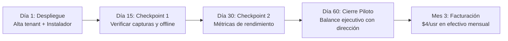

# Cliente — ALL PRINT

> [!info] Resumen del Acuerdo
> All Print es el **Cliente Piloto #1 y Caso de Éxito Fundador** para la suite **Calibre** (desarrollada por FORJADO). Participa bajo el *Programa de Expansión Regional & Adopción Temprana (Early Adopter)* con 60 días de prueba bonificados al 100% y tarifa preferencial congelada de por vida.

---

## 1. Datos Generales

| Campo | Valor |
|---|---|
| **Empresa / Razón Social** | **All Print** |
| **Tipo de Empresa** | Mipyme (Micro, Pequeña y Mediana Empresa privada) |
| **Ubicación Geográfica** | **Cienfuegos, Cuba** |
| **Sector de Actividad** | Impresión digital, gigantografías, diseño gráfico, cartelería y publicidad exterior |
| **Plantilla Estimada** | ~8 a 15 colaboradores (diseñadores, impresores, operarios de taller y administración) |
| **Servicio FORJADO** | **Calibre PRO** (Control de Jornada, Evidencia Visual y Auditoría de Rendimiento) |
| **Estado Comercial** | 🟢 **Piloto Activo — 60 Días Bonificados (Marzo — Mayo 2026)** |

---

## 2. Condiciones Comerciales Acordadas

1. **Fase Piloto VIP (60 Días / 2 Meses):**
   * **Costo:** **$0.00 USD** (100% bonificado, sin compromisos ni tarjetas bancarias).
   * **Plan Activado:** **Calibre PRO Completo** (capturas de pantalla con intervalo configurable, clasificación de aplicaciones y sitios web, turnos y horarios, reportes de nómina y proyectos ilimitados).
   * **Compromiso Mutuo:** Uso diario del cliente de escritorio en las computadoras de diseño y producción de All Print, con checkpoints periódicos de rendimiento y consumo de datos.
   * **Contraprestación:** Autorización para utilizar el logo y testimonio de All Print como el primer caso de éxito de Calibre en Cuba.

2. **Tarifa Post-Piloto (Mes 3 en adelante):**
   * **Tarifa Unitaria Preferencial:** **$4.00 USD por usuario activo al mes** (ahorro superior al 55% sobre la tarifa de lista oficial de $8.99 USD).
   * **Precio Congelado:** Garantizado de por vida mientras la cuenta se mantenga activa.
   * **Facturación Elástica:** Solo se liquidan los colaboradores que hayan registrado actividad en el mes. Si la plantilla varía de 10 a 7 personas, el cobro baja de inmediato.

3. **Canal y Modalidad de Cobro:**
   * **Forma de Pago:** **Efectivo en mano** (liquidación directa a mes vencido).
   * **Moneda:** En **USD físico** o su equivalente en **CUP** a la tasa de cambio informal convenida al momento de la entrega.
   * **Ventaja:** Cero dependencia de pasarelas de pago internacionales bloqueadas en Cuba (Stripe) y cero comisiones bancarias.

---

## 3. Especificaciones Técnicas y Parámetros del Sistema

### 3.1. Aprovisionamiento en Base de Datos (MongoDB Atlas)
El tenant de All Print se registra en el backend de Calibre con la siguiente configuración:

```json
{
  "name": "All Print",
  "slug": "all-print",
  "plan": "pro",
  "status": "trial",
  "trialEndsAt": "2026-05-10T00:00:00.000Z",
  "platformAccess": {
    "status": "active"
  },
  "limits": {
    "maxUsers": 15,
    "screenshotRetentionDays": 60,
    "maxProjects": 20
  },
  "settings": {
    "screenshots": {
      "enabled": true,
      "intervalMinutes": 5,
      "quality": 75
    },
    "activity": {
      "idleThresholdMinutes": 5
    }
  }
}
```

### 3.2. Infraestructura y Aplicación de Escritorio
* **Instalador Windows:** `Calibre-Setup-1.2.9.exe` (NSIS x64, 106.4 MB) compilado para estaciones de trabajo Windows.
* **Resiliencia de Red (Offline-First):** Motor local SQLite (`calibre.db`) que almacena el tiempo y las capturas ante caídas o fluctuaciones de ETECSA, sincronizando automáticamente hacia Cloudflare R2 y el backend de Dokploy cuando se restablece la conexión.
* **Consumo Mínimo:** Huella ligera (~60 MB RAM) para no ralentizar el software pesado de diseño (Photoshop, Illustrator, CorelDRAW).

---

## 4. Documentación y Entregables Asociados

| Documento | Ubicación | Descripción |
|---|---|---|
| **Propuesta Ejecutiva PDF** | [`Propuesta_Calibre_FORJADO.pdf`](file:///d:/1TRABAJO/PROYECTOS/FORJADO/desarrollo/Propuesta_Calibre_FORJADO.pdf) | Documento B2B corporativo de 3 páginas con comparativa vs Time Doctor y ROI del 350%. |
| **Plantilla HTML Imprimible** | [`propuesta_calibre.html`](file:///d:/1TRABAJO/PROYECTOS/FORJADO/desarrollo/propuesta_calibre.html) | Plantilla fuente estilizada con paleta de marca FORJADO. |
| **Propuesta Comercial Markdown** | [`PROPUESTA_MIPYME_CALIBRE.md`](file:///d:/1TRABAJO/PROYECTOS/FORJADO/desarrollo/PROPUESTA_MIPYME_CALIBRE.md) | Versión editable con el detalle de condiciones comerciales. |
| **Código Fuente Suite Calibre** | `aplicaciones/forjado/time-control/` | Repositorios backend, frontend web y cliente desktop. |

---

## 5. Cronograma de Acompañamiento Operativo



1. **Hito 1 (Día 1):** Alta de la organización en la consola web con el correo del administrador de All Print y entrega del instalador `Calibre-Setup-1.2.9.exe`.
2. **Hito 2 (Día 15):** Auditoría técnica: verificar que la subida de capturas a Cloudflare R2 y la sincronización offline operen sin latencia en Cienfuegos.
3. **Hito 3 (Día 30):** Reporte intermedio de productividad y horas efectivas entregado a la dirección de All Print.
4. **Hito 4 (Día 60):** Balance ejecutivo del piloto y confirmación de la nómina activa para el servicio regular.
5. **Hito 5 (Mes 3 en adelante):** Conteo mensual de usuarios activos y recepción de la liquidación en efectivo.
