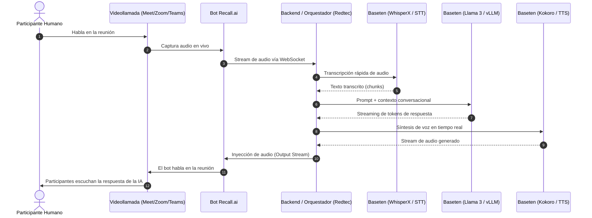

# Partner / Cliente — Garoo / Redtec

> [!info] Cómo leer esta página
> Página **compilada**: resume el perfil corporativo, la infraestructura y el uso estratégico y técnico de las herramientas de IA adoptadas por **Garoo / Redtec**. El registro histórico y logs de configuración viven en [[../../raw/clientes/garoo-redtec/2026-10-29-adopcion-recall-ai-y-baseten|raw/clientes/garoo-redtec/]].

---

## 1. Perfil y Ecosistema

| Campo | Valor |
|---|---|
| **Organización** | Garoo / Redtec (`redtec.ai`) |
| **Relación con FORJADO** | Partner tecnológico / Cliente corporativo en desarrollo de agentes de IA y arquitecturas avanzadas |
| **Infraestructura Core** | Instancia de agentes en producción (`agentsprod.redtec.ai`), repositorios de agentes (ej. `Garoo/Agent-Spectrum`), bases de datos vectoriales en MongoDB Atlas y enrutamiento con OpenRouter |
| **Nuevas Plataformas (10-2026)** | **Recall.ai** (bots e interfaces para reuniones) y **Baseten** (inferencia y hosting de modelos ML en GPU) |

---

## 2. Plataforma: Recall.ai

- **Dashboard:** [https://us-east-1.recall.ai/dashboard/](https://us-east-1.recall.ai/dashboard/) (Región: `us-east-1`)
- **Qué es:** Infraestructura API unificada para videoconferencias. Permite desplegar "bots virtuales" que se conectan de manera autónoma a llamadas en vivo sin requerir plugins locales ni integraciones complejas por plataforma.
- **Plataformas compatibles:** Google Meet, Zoom, Microsoft Teams, Cisco Webex y Slack Huddles.

### Capacidades Técnicas Clave
1. **Despacho Programado y Bajo Demanda:** Endpoint `POST /api/v1/bot` que recibe la URL de la reunión, nombre visible del bot, avatar y configuraciones de grabación/transmisión.
2. **Streaming de Audio/Video en Tiempo Real:**
   - **Input Stream:** Captura de audio en vivo con separación de canales por participante (raw PCM o WebSockets).
   - **Output Stream:** Capacidad de inyectar audio sintetizado (voz de IA) y video/avatar animado directamente en la llamada.
3. **Transcripción en Vivo y Diarización:** Transcripción continua con identificación de hablantes (speaker diarization) y marcas temporales palabra por palabra.
4. **Webhooks de Estado y Grabaciones:** Notificaciones en tiempo real para eventos de ciclo de vida (`bot_joined`, `speaker_started`, `bot_left`) y almacenamiento automático de grabaciones MP4/WAV en almacenamiento en la nube (S3, GCS).

### Casos de Uso y Aplicaciones en Garoo / Redtec
- **Agente Virtual Interactivo en Videollamadas:** Bots que asisten a reuniones con clientes para realizar demos, responder preguntas frecuentes, recopilar requerimientos o validar información técnica en tiempo real.
- **Copiloto en Vivo para Reuniones de Ventas y Consultoría:** El bot asiste de forma silenciosa, transcribe la sesión en vivo y alimenta un sistema interno que asiste al consultor con objeciones, datos técnicos o resúmenes instantáneos.
- **Automatización Post-Reunión (Meeting Intelligence):** Extracción automatizada de minutas, compromisos (*action items*), métricas de participación y sincronización directa con CRMs y herramientas de gestión (Notion, HubSpot, n8n).

---

## 3. Plataforma: Baseten

- **Dashboard:** [https://app.baseten.co/overview](https://app.baseten.co/overview)
- **Qué es:** Plataforma de inferencia y despliegue de modelos de Machine Learning sobre GPUs de alto rendimiento (NVIDIA A10G, A100, H100) en modo serverless o con capacidad dedicada.
- **Framework de Trabajo:** **Truss** (herramienta open-source desarrollada por Baseten para empaquetar modelos con dependencias, pre/post-procesado y testing local antes de desplegar).

### Capacidades Técnicas Clave
1. **Motores de Inferencia Optimizados:** Compatibilidad nativa con motores de alta aceleración como **vLLM** y **TensorRT-LLM**, maximizando el throughput de tokens/segundo y reduciendo drásticamente la latencia al primer token (*Time to First Token - TTFT*).
2. **Modelos Open Source Privados:** Despliegue seguro de modelos líderes de código abierto (ej. **Llama 3 / 3.1 / 3.3**, **DeepSeek**, **Mistral**, **WhisperX**, **Kokoro TTS**, **XTTS**, **Flux**) bajo control total de la infraestructura.
3. **Autoscaling y Eficiencia de Costes:** Capacidad de escalar a cero (*scale-to-zero*) cuando no hay tráfico para reducir gastos, o fijar réplicas calientes para garantizar latencias predecibles en sistemas de producción.
4. **Streaming Bidireccional y APIs REST:** Endpoints seguros con autenticación vía API Key, entrega de respuestas por Server-Sent Events (SSE) e integración fluida con SDKs de Python, TypeScript y workflows de n8n.

### Casos de Uso y Aplicaciones en Garoo / Redtec
- **Inferencia Privada y Reducción de Costos en LLMs:** Sustituir o complementar llamadas a modelos cerrados (OpenAI/Anthropic) por modelos abiertos corriendo en Baseten con vLLM, logrando menor costo marginal por token en altos volúmenes y soberanía de datos.
- **Pipeline de Voz con Latencia Sub-segundo:** Despliegue de modelos de transcripción ultrarrápida (WhisperX) y modelos modernos de Text-to-Speech (como Kokoro TTS o Chatterbox) para dotar a los agentes de voz de respuestas casi humanas (< 300 ms).
- **Modelos Especializados y Fine-Tuning de Clientes:** Alojamiento de modelos afinados con terminología propia del sector (como el mercado inmobiliario de Spectrum o procesos legales/financieros) sin riesgos de compartir datos de entrenamiento con terceros.

---

## 4. Sinergia y Arquitectura Conjunta (Pipeline en Tiempo Real)

Al combinar **Recall.ai** (interfaz de reunión) con **Baseten** (motor de cómputo de inferencia), Garoo / Redtec puede construir un pipeline autónomo de agentes de voz para videoconferencias de latencia ultra baja:

---

## 5. Matriz de Integración Operativa

| Herramienta | Rol en la Arquitectura | Conexión con el Ecosistema Redtec |
|---|---|---|
| **Recall.ai** | Punto de contacto y captura en videollamadas | Se comunica mediante Webhooks y WebSockets hacia el backend de agentes o webhooks de n8n (`agentsprod.redtec.ai`). |
| **Baseten** | Infraestructura de cómputo e inferencia GPU | Endpoints REST/SSE invocados directamente desde nodos HTTP en n8n o microservicios Python de Redtec. |
| **n8n / Backend** | Lógica de negocio y orquestación | Controla el ciclo de vida del bot, almacena contexto en MongoDB y gestiona las herramientas/RAG del agente. |
| **MongoDB Atlas** | Memoria persistente y base de conocimiento | Guarda transcripciones, resúmenes, vector embeddings y metadatos de las sesiones. |

---

## 6. Estado y Próximos Pasos

- [x] Registro inicial de cuentas y consolas en Obsidian.
- [ ] Configurar el primer bot de prueba en Recall.ai conectado a una llamada de Google Meet.
- [ ] Evaluar el primer despliegue de modelo en Baseten con Truss (WhisperX o Kokoro TTS para benchmarks de latencia).
- [ ] Diseñar el workflow piloto en n8n (`agentsprod.redtec.ai`) para procesar el webhook post-reunión de Recall.ai y generar minutas automáticas.

---

## Relacionado

- [[../../raw/clientes/garoo-redtec/2026-10-29-adopcion-recall-ai-y-baseten|Log crudo de adopción (2026-10-29)]]
- [[carwarriors-llc-arquitectura-migracion|Arquitectura de referencia (Agent-Spectrum)]]
- [[../interno/operaciones/herramientas-y-stack|Herramientas y Stack de FORJADO]]
- [[../index|Índice de la bóveda]]
