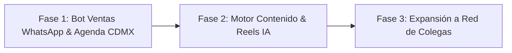

# Cliente — Rogers México

> [!info] Cómo leer esta página
> Página **compilada**: refleja el estado actual del cliente, su modelo de negocio y el plan de trabajo por fases. El historial cronológico y crudo vive en [[../../raw/clientes/rogers-mexico/2026-09-21-requerimientos-audios-rogers|raw/clientes/rogers-mexico/]] (ver [[../../README|arquitectura de la bóveda]]).

## Datos

| Campo | Valor |
|---|---|
| **Empresa / Marca** | Rogers México |
| **Contacto principal** | **Rogers** |
| **Ubicación / Mercado** | Ciudad de México (CDMX) y Zona Metropolitana (Edomex) |
| **Sector** | Telecomunicaciones residenciales, redes WiFi, CCTV y antenas de TV a domicilio |
| **Servicio principal FORJADO** | Automatización e IA (Agente conversacional de ventas en WhatsApp + CRM) |
| **Estado** | 🟡 Propuesta enviada / Pendiente llamada de alineación de Fase 1 |
| **Canales oficiales** | Tel: `+52 55 8830 1030` · [WhatsApp Directo](https://wa.me/5215588301030) |
| **Web actual (Staging)** | [https://rogers.mangeldev.com?v1](https://rogers.mangeldev.com?v1) |

## Modelo de negocio de Rogers México

- **Propuesta de valor:** Instalación técnica garantizada a domicilio sin anticipos ("Pagas al terminar"), con medición y diagnóstico en sitio.
- **Líneas de servicio activas:**
  1. **WiFi Cobertura:** Repetidores y puntos de acceso para eliminar puntos ciegos.
  2. **WiFi Mesh:** Red unificada para casas grandes de 2 a 3 plantas.
  3. **Antenas TV HD:** Señal abierta sin mensualidades con hasta 24 meses de garantía.
  4. **Cámaras de Seguridad CCTV:** Instalación, cableado estético y configuración de app móvil con capacitación.
  5. **Redes PyME:** Cableado Ethernet y equipamiento de red para locales y oficinas.

## Plan de implementación por fases

### Fase 1: Automatización de Ventas y Calificación en WhatsApp (Inmediata)
- **Objetivo:** Convertir el tráfico web y redes en instalaciones confirmadas sin perder leads por demora humana.
- **Alcance:**
  - Agente IA 24/7 en WhatsApp Business con personalidad técnica y directa de Rogers México.
  - Validación de cobertura inmediata por Código Postal / Alcaldía / Municipio (CDMX y zona conurbada).
  - Filtro y diagnóstico básico (problema de señal, número de plantas, cámaras requeridas).
  - Pre-cotización orientativa y agendamiento de visita técnica en calendario.
  - Notificación instantánea de nueva cita a Rogers con datos completos del cliente.

### Fase 2: Motor de Contenido y Reels con IA (Crecimiento orgánico)
- Generación de guiones y piezas de video/reels sobre casos reales de instalación (WiFi vs muros gruesos, cámaras de seguridad, TV abierta).
- Programación de publicaciones para TikTok, Instagram y Facebook.

### Fase 3: Estandarización y Plataforma para Red de Colegas (Escala)
- Rogers cuenta con una red de contactos en el mismo rubro técnico en México y otros países.
- Una vez validado el retorno en Rogers México, empaquetar la solución en formato producto/SaaS para distribuir a sus colegas.

## Pendientes abiertos

- [ ] Realizar llamada de 10 minutos con Rogers para validar la Fase 1.
- [ ] Definir tarifa de implementación (setup) y fee mensual de mantenimiento/servidor para la Fase 1.
- [ ] Recibir confirmación de cuenta de WhatsApp Business y credenciales operativas.

## Historial reciente

- **2026-09-21:** Recepción de audios de Rogers planteando sistematización integral y red de colegas. Estructuración y envío de propuesta en 3 fases secuenciales ([[../../raw/clientes/rogers-mexico/2026-09-21-requerimientos-audios-rogers|detalles en raw]]).
- **2026-09-21:** Levantamiento y análisis inicial de la web de staging `https://rogers.mangeldev.com?v1` ([[../../raw/clientes/rogers-mexico/2026-09-21-analisis-inicial-rogers-mexico|detalles en raw]]).
