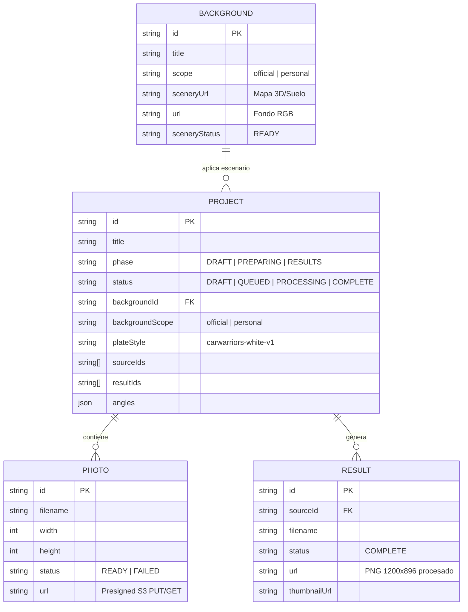
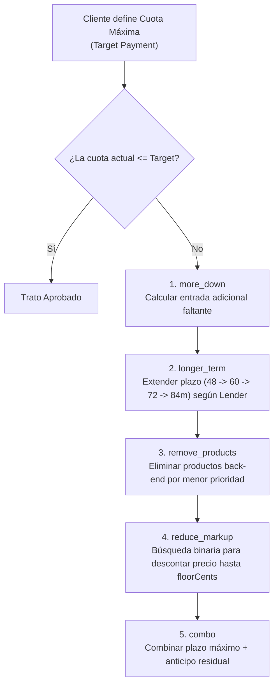

# Blueprint Técnico: Ingeniería Inversa y Arquitectura de Cleverwave

> **Documento Interno FORJADO — Confidencial**  
> **Fecha de captura:** 10 de Noviembre de 2026  
> **Objetivo:** Registro integral de arquitectura, esquemas de datos, algoritmos y flujos de Cleverwave (`carwarriors-dev.cleverwave.ai`) para el diseño y construcción de la plataforma propia de FORJADO.  
> **Dump de archivos crudos:** `raw/clientes/carwarriors-llc/cleverwave-dump/`

---

## 1. Ficha Técnica y Topología de Infraestructura

Cleverwave es una solución SaaS para concesionarios de automóviles montada sobre el ecosistema **AWS Amplify Gen 2**:

| Componente | Configuración / Identificador |
|---|---|
| **Frontend Web** | Vite SPA (React 19 / Rolldown / PostHog Telemetry) en CloudFront CDN |
| **Dominio Auditado** | `https://carwarriors-dev.cleverwave.ai` |
| **Región AWS** | `us-east-1` (N. Virginia) |
| **AWS Account ID** | `843968570659` |
| **Cognito User Pool ID** | `us-east-1_Mh9lgirSY` |
| **Cognito Client ID** | `60epbe3v1igf9ngluhtj8urehd` |
| **Cognito Identity Pool** | `us-east-1:1c60e013-adf5-4b80-81b6-a1e80790ca43` |
| **GraphQL API (AppSync)** | `https://cfkepaknsrem3mgfthrrwemjfa.appsync-api.us-east-1.amazonaws.com/graphql` |
| **Autorización AppSync** | `AMAZON_COGNITO_USER_POOLS` (Bearer JWT en header `Authorization`) |
| **Bucket S3 Primario** | `amplify-d34zllt7hrxwk3-dev-branch-7-photosb9552d0d-k68vkiopntzc.s3.us-east-1.amazonaws.com` |
| **Lambdas Backend Principales** | • `amplify-d34zllt7hrxwk3-de-carwarriorsagentjobslamb-w16sNv6mrY4J`<br/>• `amplify-d34zllt7hrxwk3-de-carwarriorsdealercenterj-2YfJwN9bleOw`<br/>• `amplify-d34zllt7hrxwk3-de-carwarriorssourcingjobsl-vQEOMYT5vqax` |
| **Tópico SNS de Alertas** | `arn:aws:sns:us-east-1:843968570659:amplify-d34zllt7hrxwk3-dev-branch-7e8b9aad99-data7552DF31-YXRKKS52YEY1-OperationsAlerts9AB0B5C5-iXQuVCn9gvgA` |

---

## 2. Módulo Car Studio IA: Reemplazo de Fondos y Matrículas

### 2.1 Esquema de Entidades (Data Models)

El almacenamiento en DynamoDB y S3 se organiza en 4 entidades bajo la mutation AppSync `sellerPhotos`:



### 2.2 Clasificación de Ángulos
Cleverwave clasifica las tomas en 12 categorías:
* **Exteriores:** `front`, `front-left`, `left`, `rear-left`, `rear`, `rear-right`, `right`, `front-right`.
* **Interiores y Técnicos:** `interior`, `detail`, `odometer`, `engine`.
* **Comportamiento clave:** Si el ángulo es clasificado como `interior`, el sistema **no recorta el fondo**; aplica únicamente balance de curvas tonales, reducción de ruido y realce de contrastes.

### 2.3 Desacoplamiento de Fondo ("Background" vs "Scenery")
En Cleverwave, un escenario no es un JPEG estático:
1. **`background.png`**: Imagen artística/fotorrealista del estudio (paredes, iluminación de techo, logo del dealer).
2. **`scenery.png`**: Plano de proyección de suelo (*Ground Plane Mesh*). Permite que el motor de render calcule dónde termina el muro y dónde comienza la superficie de asfalto/piso sobre la que se apoyan las ruedas.

### 2.4 Síntesis de Sombras de Contacto (Ground Shadow Synthesis)
Para evitar el efecto de "auto flotando" o recorte artificial:
1. **Sombra Oclusiva (Ambient Occlusion):** Se genera una elipse oscurecida de contacto directo con radio estrecho justo en el punto de apoyo de cada neumático.
2. **Sombra Direccional Difusa (Soft Drop Shadow):** Un gradiente semitransparente proyectado hacia adelante o hacia los lados según la inclinación de las luces cenitales del `scenery.png`.

### 2.5 Inserción de Matrícula Corporativa (`plateStyle`)
* En tomas `front`, `rear`, `front-left` o `rear-left`:
  1. Detección del polígono de 4 vértices de la placa original.
  2. Transformación de homografía 2D (perspectiva warp) de la textura del dealer (`plateStyle: "carwarriors-white-v1"`).
  3. Ajuste de grano, viñeteado y brillo ambiental para mimetizarse con el parachoques.

### 2.6 Pipeline de Ejecución Headless (API GraphQL)
Para procesar un vehículo de forma 100% automatizada sin usar el navegador:

```graphql
mutation ExecuteSellerPhotos($op: String!, $data: AWSJSON!) {
  sellerPhotos(operation: $op, input: $data)
}
```

1. **Crear Proyecto:**
   * `$op`: `"createProject"`
   * `$data`: `{"id": "uuid-v4", "title": "2024 Hyundai Tucson - R300375"}`
2. **Pedir URLs de Subida:**
   * `$op`: `"prepareUpload"`
   * `$data`: `{"projectId": "...", "files": [{"filename": "01.jpg", "size": 1500000}]}`
   * *Retorna:* URLs pre-firmadas `PUT` a Amazon S3.
3. **Subir Binarios:**
   * `PUT` directo a cada URL de S3 con cabecera `Content-Type: image/jpeg`.
4. **Confirmar Recepción:**
   * `$op`: `"completeUpload"`
   * `$data`: `{"projectId": "...", "photoIds": ["..."]}`
5. **Vincular Escenario y Matrícula:**
   * `$op`: `"prepareProject"`
   * `$data`: `{"id": "...", "backgroundId": "f9ec4e4c-98ee-4aa2-9b49-d3e323faab07", "backgroundScope": "official", "plateStyle": "carwarriors-white-v1"}`
6. **Disparar Inferencia de IA:**
   * `$op`: `"generateProject"`
   * `$data`: `{"id": "..."}`
7. **Polling de Resultados:**
   * `$op`: `"project"`
   * `$data`: `{"id": "..."}`
   * Se sondea cada 5 segundos hasta que `status === "COMPLETE"`. Cada registro en `records` con `kind === "RESULT"` contiene la URL presigned directa de descarga.

---

## 3. Módulo Purchasing / Buy-Box: Algoritmos de Subasta y Reemplazo

El código desofuscado en `repository-B8CNeQ7W.js` y `BuyingRules-DB6LODZr.js` expone el motor matemático de decisiones de compra:

### 3.1 Criterios de Calificación de Reemplazo
Cuando el dealer vende un vehículo, el sistema busca en subastas unidades similares para recomponer stock bajo la siguiente fórmula de rentabilidad mínima requerida:

$$\text{Requerimiento de Utilidad} = \max\left(\text{minProfitCents},\ \text{SoldNetProfit} - \text{toleranceCents}\right)$$

### 3.2 Reglas de Validación
1. **Margen Negativo:** Si $\text{Margen Estimado} \le 0 \implies \text{Estado: REJECTED (NONPOSITIVE_PROFIT)}$.
2. **Evidencia Caducada:** Si la fecha del avalúo o subasta ($\text{observedAt}$) supera `maxEvidenceAgeHours` (máx. 24–48 horas) $\implies \text{Estado: PENDING (STALE_EVIDENCE)}$.
3. **Presupuesto Máximo:** Si $\text{Costo de Adquisición} > \text{maxPurchaseCents} \implies \text{Estado: REJECTED (OUTSIDE_CRITERIA)}$.
4. **Scoring Ponderado (0 a 100 puntos):**
   $$\text{Score} = \left(\frac{\text{Profit}}{\text{targetProfitCents}} \times \text{profitWeight}\right) + \left(\frac{\text{targetDaysToSell}}{\text{DaysToSell}} \times \text{turnoverWeight}\right)$$

---

## 4. Módulo F&I Desk: Optimizador de Cuota ("Target Solver")

El código en `target-solver-BVgf3-5Z.js` y `lender-caps-C5bGR1iy.js` resuelve cómo cerrar tratos cuando un comprador tiene un tope mensual rígido (ej. $450/mes):

### 4.1 Árbol de Resolución Heurística (5 Levers)



### 4.2 Restricciones de Políticas (Lender Caps)
* `floorCents`: Margen mínimo permitido por el dealer. El solver nunca reduce productos por debajo de este suelo sin requerir aprobación de gerencia (`needsApproval: true`).
* Plazos permitidos por matriz financiera: `[24, 36, 42, 48, 54, 60, 66, 72, 75, 78, 84]` meses.

---

## 5. Módulo Attendance: Geocercas y Bloqueo de Workspace

El sistema utiliza control horario con validación estricta de coordenadas para habilitar el uso de la plataforma:
* **Mecanismo:** El backend rechaza cualquier llamada a `sellerPhotos` con error `AttendanceRequired` si el usuario no tiene una sesión diaria con `active: true`.
* **Oficina Car Warriors Miami:**
  * Dirección: `3620 NW 27th Ave, Miami, FL 33142, USA`
  * Coordenadas: `lat: 25.8096774, lng: -80.2406603`
  * Radio de tolerancia: `150 metros`
  * Precisión GPS requerida: `< 100 metros`

---

## 6. Arquitectura Recomendada para la Solución Propia de FORJADO

Para construir nuestra propia alternativa sin pagar licencias de Cleverwave ni toparnos con el límite de 120 fotos/día:

```mermaid
flowchart LR
    A["DealerCenter / WhatsApp / Portal Web"] --> B["API Gateway FORJADO<br/>(FastAPI / Node.js)"]
    B --> C["Worker de Inferencia<br/>(GPU Serverless / RunPod)"]
    C --> D["1. Segmentación: BiRefNet<br/>(Transparencia vidrios)"]
    D --> E["2. Fondo + Sombras: IC-Light v2<br/>(Composición de Suelo)"]
    E --> F["3. Placa: OpenCV Homography<br/>(Perspective Warp)"]
    F --> G["Storage S3 / MinIO FORJADO"]
    G --> H["Actualización DealerCenter<br/>(Playwright / SFTP directo)"]
```



### Ventajas Competitivas de la Solución Propia:
1. **Cero cuotas artificiales:** Procesamiento ilimitado (hasta miles de fotos/hora según GPU).
2. **Costo por vehículo reducido en un 90%:** Costo estimado de GPU de ~$0.05 por auto procesado (lote de 12 fotos).
3. **Multi-Tenant para N Dealers:** Capacidad de ofrecer plantillas de estudio personalizadas a cualquier concesionario de Florida o EE.UU. con su propia identidad visual y matrícula.
4. **Integración F&I + Buy-Box:** Posibilidad de empaquetar el cotizador de financiamiento y el evaluador de subastas como un producto de software integral bajo la marca de FORJADO.
